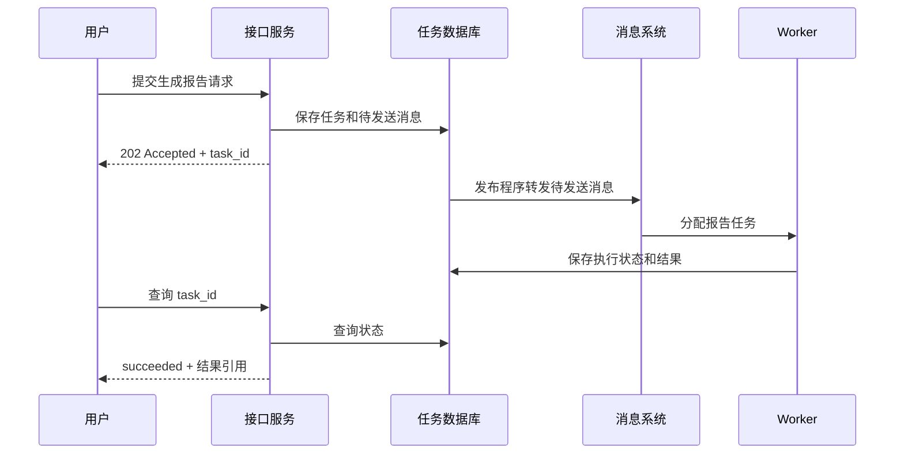

# 01｜一个两分钟的任务，为什么需要消息队列

[学习目录](../README.md) · [下一篇：队列、日志与消费组 →](02-队列日志与消费组.md)

> 前置：知道 HTTP 请求和数据库写入。目标：能判断一个任务是否值得引入持久队列。

用户点击“生成研究报告”。后端要读取资料、调用模型、执行工具、整理结果，再保存文件。一次顺利执行需要两分钟。你的第一版实现很直接：`POST /reports` 收到请求后，一直执行到报告生成，再返回文件地址。

这个接口不一定写错了。流量小、超时设置合适、用户愿意等待时，它可以工作。但当用户刷新页面、网络断开、服务部署重启时，新的问题出现了：请求不在了，任务还在吗？任务执行了一半，接下来谁继续？

## 从“函数调用”走到“可恢复的任务”

一次普通函数调用把三个时间绑在一起：请求到达的时间、程序开始处理的时间、调用方等到结果的时间。MQ 允许生产者先交付一条消息，让消费者稍后处理。它把“什么时候提交工作”和“什么时候执行工作”分开。

图中的数据库不会自己发送网络请求；`DB → MQ` 代表一个后台发布程序读取消息表后发送。为什么要先写消息表，到第 04 篇再解释。现在先关注接口语义：`202 Accepted` 表示请求已被接受，后续结果仍要查询。返回 `task_id` 以后，平台应当能从持久数据中找到它。

这比“开一个线程就返回”多了一份可恢复的记录。进程内线程、协程、内存队列都依赖当前进程存活；部署重启后，尚未完成的工作可能消失。持久消息系统配合任务数据库，才能让新进程知道还有什么没做。

## 三个好处，都有前提

**异步**缩短的是用户等待接口响应的时间。报告本身依然要生成两分钟，加上排队甚至更久。用户界面因此需要显示“排队中、执行中、已完成、失败”，而不是把接收成功伪装成完成成功。

**解耦**意味着生产者不必知道每个消费者的机器地址、实例数量和当前是否在线。例如任务完成后，通知、统计、审计可以分别读取完成事件。但大家依然依赖消息的格式与含义。“已生成”究竟表示模型输出结束，还是文件已经持久保存且可下载，必须事先约定。

**缓冲流量**允许进入速度短时间超过处理速度。假设一分钟内收到 600 个任务，而 Worker 每分钟完成 200 个，那么一分钟后约积压 400 个。只要后续进入速度降下来，就有机会消化；如果此后每分钟仍进来 600 个，队列只会越来越长。

这三个好处都不是无条件成立。Broker 无法写入时，上游仍要面对失败；队列容量耗尽时仍需限流；下游无限期故障时，平台不能无限期声称“一切正常”。

## 为什么不用异步 HTTP、Redis 或数据库

这些都是合理问题，因为 MQ 是一个会增加运维成本的组件。

异步 HTTP 客户端能让一个线程在等待网络时做别的事，但没有自动保存“这个请求应该在进程重启后继续尝试”。HTTP 也可以做可靠的异步任务协议，前提是你另外实现持久任务状态、重试和接管。

数据库可以充当任务队列。使用事务领取任务、保存租约、记录重试时间，很多小系统足够用。难点随着并发增长出现：锁竞争、轮询成本、历史数据清理、热点任务、公平调度。不能仅因为“没有 MQ”就判断架构不专业。

Redis 也要区分具体功能。普通 Pub/Sub 面向在线订阅者，不应当被当成持久任务库；Redis Streams 提供消费组与待确认记录，但确认、接管、裁剪和持久化策略仍需设计。官方的 [XREADGROUP](https://redis.io/docs/latest/commands/xreadgroup/) 与 [XAUTOCLAIM](https://redis.io/docs/latest/commands/xautoclaim/) 分别对应消费与接管。

| 选择 | 适合的起点 | 要承担的责任 |
|---|---|---|
| 同步请求 | 短任务，用户必须立刻拿到结果 | 超时、失败返回、重试副作用 |
| 进程内后台执行 | 可丢弃、可重新计算的小工作 | 进程退出后的丢失风险 |
| 数据库任务表 | 规模有限，团队已经熟悉数据库 | 领取、租约、轮询、清理与竞争 |
| 专门的 MQ | 需要独立扩展、多消费者和成熟投递机制 | Broker 运维及端到端业务一致性 |

选型应当从工作负载和故障要求出发。第一个版本只有几十个任务，数据库任务表可能更容易维护；系统需要多个独立订阅者、持续高流量和历史重放时，再评估专门的消息基础设施。

## 用户刷新页面以后，结果为什么还在

报告任务应有稳定标识，例如 `task_id=task-123`。前端通过它查询数据库，不依赖最初的 HTTP 连接。SSE 或 WebSocket 可以推送进度，但连接断开后还应允许重新查询当前状态。

创建任务的接口也需要处理重复点击。假设服务已经创建任务，返回途中网络断了。浏览器重试后若再创建一个任务，用户就付出了两份模型调用成本。可以由客户端生成请求幂等键，服务端以 `(tenant_id, request_key)` 建唯一约束；相同键和相同请求返回原来的任务，相同键配不同内容则报冲突。

这和 MQ 重复投递是两个不同位置的重复：一个发生在用户到 API，另一个发生在 MQ 到 Worker。队列不会自动替接口消除重复点击。

## 什么时候先别异步化

如果用户请求的是“这件商品现在能否成功预订”，而界面立即承诺成功，那么决定预订成败的库存校验和预留必须形成可靠结果。你当然可以改为异步抢购，但产品语义要变成“申请已受理，稍后查看结果”。

同样，Agent 的任务接收可以异步化，但用户对一个危险工具操作的授权不能被一个过期消息悄悄替代。执行时仍应检查授权是否有效，任务是否取消，以及预算是否剩余。异步拉长了提交与执行之间的时间差，这段时间里世界会变化。

## 用一道题检查理解

系统收到请求后先返回任务编号，再只把任务放入进程内队列。五秒后服务重启。平台还能履行“稍后给你结果”的承诺吗？

不能仅靠内存队列履行。它至少需要在返回前保存可恢复的任务意图，并让后台程序能够重新发现未完成工作。这里先建立的是“可靠接受”的边界；下一篇看这份工作进入消息系统后，会怎样保存和分发。
