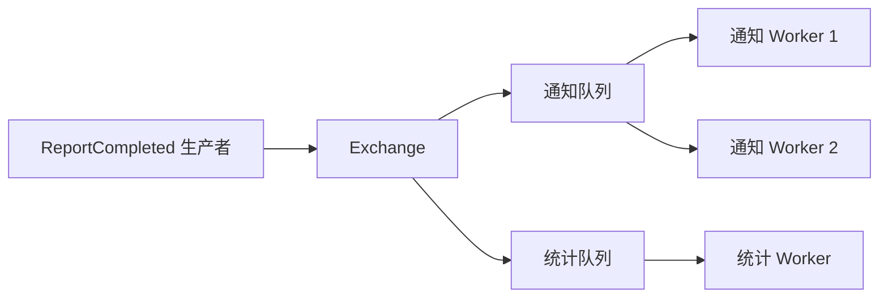

# 02｜消息究竟放在哪里：队列、日志与消费组

[← 上一篇](01-从一次Agent任务理解MQ.md) · [学习目录](../README.md) · [下一篇 →](../02-入门篇/03-消息的一生与确认边界.md)

> 前置：第 01 篇。目标：能画出竞争消费和独立订阅，并分清队列确认与日志位点。

报告任务进入消息系统后，有三个 Worker 空闲。我们希望其中一个生成报告，另外两个处理别的报告。但报告完成后，又希望“通知服务”和“统计服务”都知道。这是两种不同需求：**分担一份工作**与**各自观察同一件事**。

## 工作队列：多个 Worker 分担待办

把 `task-1、task-2、task-3` 放入一个工作队列，三个 Worker 作为竞争消费者。一次投递会分配给某个消费者；处理完成并确认后，这份待办可以被移除。

“一份工作交给一个 Worker”不等于“历史上永远只交给一个 Worker”。W1 处理时连接断开，Broker 可能把尚未确认的消息交给 W2。W1 甚至可能只是网络不通，仍然在执行。由此产生的并发重复，需要第 04 篇的幂等和第 06 篇的执行权控制。

工作队列通常不会因为消费者想复盘，就保留已经确认的全部消息。若需要长期审计，要另外保存业务事件或选择适合重放的存储模型。

## 独立订阅：通知和统计各有自己的进度

在 RabbitMQ 常见的 AMQP 0-9-1 模型里，生产者向 **Exchange（交换机）** 发布消息。Exchange 按 binding（绑定关系）把消息路由到一个或多个 queue。queue 才是排队和消费的实体。



通知队列内部的 N1、N2 分担通知；统计队列拥有自己的副本与处理进度。如果把通知和统计放进同一个队列里竞争，一条完成事件可能只被通知服务拿走，统计服务就看不到它。

Exchange 的常见路由形式包括按 routing key 精确匹配的 direct、按模式匹配的 topic，以及向绑定队列分发的 fanout。注意 RabbitMQ 的 topic exchange 是一种路由规则，不能直接套用 Kafka topic 的存储含义。[RabbitMQ 发布订阅教程](https://www.rabbitmq.com/tutorials/tutorial-three-python)展开了这个区别。

## 日志模型：消息保留，读者记住自己的位置

Kafka 常规消费组使用另一种思路。一条 topic 被拆成多个 partition，每个 partition 是一条有序追加日志。消息写进去后，可以保留一段时间或按其他保留策略清理；消费完成通常只更新读者进度，不立即删除消息。

```text
topic: report-events

partition 0: [offset 0][offset 1][offset 2][offset 3]...
partition 1: [offset 0][offset 1][offset 2]...

通知组：P0 下一条读 3，P1 下一条读 2
统计组：P0 下一条读 1，P1 下一条读 0
```

Offset 只在某个分区内有意义，`P0:3` 与 `P1:3` 不是同一条消息。提交的位点通常表示**下次要读取的位置**：已经成功处理到 offset 41，正常应提交 42。

同一个常规消费组内，一个分区同一时刻分配给一个消费者；一个消费者可以负责多个分区。两个消费者面对四个分区，可能各负责两个；八个消费者面对四个分区，一些实例会闲置。不同消费组则可以独立读取相同日志。

这里特意限定“常规消费组”。Kafka 的 share groups 等机制有不同的分配与确认语义，不能把分区独占规则推广到所有模式。本文沿用普通 consumer group 模型，版本资料见 [Kafka 4.1 Design](https://kafka.apache.org/41/design/design/)。

## 分区为什么既提高并行度，又限制顺序

假设使用 `task_id` 作为 key，分区器据此决定消息进入哪个分区。同一任务的消息在分区映射不变时进入同一分区，便于按任务顺序处理；不同任务可以分散到不同分区并行。

但这不是“同一个任务永远在同一台机器”。分区领导者可能迁移，消费者可能重分配；扩分区也可能改变 key 的未来映射。稳定的是设计出来的业务顺序约束，实际实例归属是可变化的。

全局只有一条顺序流时，所有任务可能被一个慢任务拖住。更常见的要求是“同一订单、同一会话或同一任务内有序”，这样可以在多个业务 key 之间并行。如何处理单个 key 过热，在第 05 篇继续。

## Kafka 的性能从哪里来

日志让许多小写入能够组织成顺序追加；批量收发摊薄网络和系统调用开销；页缓存帮助热点数据复用；批次压缩降低传输和存储量。满足条件时，文件到网络的零拷贝路径还能减少用户态搬运。

不要把这些机制背成“磁盘和内存一样快”或“Kafka 完全不分配 Java 对象”。顺序带宽、随机访问延迟、缓存命中是不同指标；TLS、数据格式转换、压缩处理等路径也会影响复制与 CPU 开销。理解优化针对什么成本，比背一个“百万吞吐”数字更有用。

队列模型也能有很高吞吐，日志模型也能处理业务任务。产品性能必须结合消息大小、复制要求、批次、延迟目标和消费逻辑测量，不能由产品名字决定。

## Push、Pull 和背压

RabbitMQ 常见用法是消费者注册订阅后，由 Broker 投递；`prefetch` 限制同时在途且尚未确认的消息数量。它也提供 `basic.get` 主动获取消息。Kafka 常规消费者使用拉取，客户端可以批量读取，但仍可能一次把太多消息交给业务线程池。

因此“pull 就不会压垮消费者”不成立。任何模型都需要限制在途工作。假设一个任务占用 200 MB 内存，客户端一次预取 1,000 个并全部展开处理，仅应用内存就可能先耗尽。背压的意思是让上游感知处理能力，减慢投递或拒绝新工作，而不只是把缓冲区设得更大。[RabbitMQ 确认与预取文档](https://www.rabbitmq.com/docs/4.1/confirms)描述了预取窗口。

## 读完后画两张图

第一张：三个 Worker 共同生成报告。第二张：报告完成后，通知和统计分别处理事件。如果第一张没有竞争关系，可能重复执行工作；如果第二张只有一份竞争队列，可能漏掉一个订阅者。

再回答一个问题：Kafka 统计组停机两天后，能否继续读取之前的消息？答案取决于它的位点，以及相应消息是否仍在保留范围内。能保存位点，不代表消息会无限期保留。
