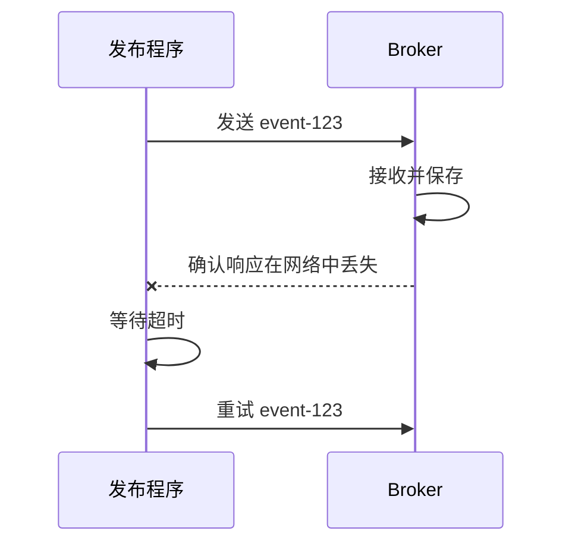

# 03｜跟着一条消息走完发送、处理与确认

[← 上一篇](../01-基础篇/02-队列日志与消费组.md) · [学习目录](../README.md) · [下一篇 →](04-Outbox幂等与事务.md)

> 前置：第 02 篇。目标：面对一次超时，能说清“知道什么、不知道什么、能否重试”。

平台准备发送 `ReportRequested`。一条消息从 API 到最终报告，中间至少经过四次状态变化：发布客户端接受调用、Broker 按配置接收消息、Worker 执行业务、Worker 确认处理进度。许多事故来自把这些状态统称为“发送成功”。

## 发送函数返回，究竟说明了什么

有的客户端 `send()` 只把消息放入本地缓冲区，真正发送发生在后台。此时进程立即退出，消息可能还没离开本机。另一些调用会等待 Broker 的响应，但这个响应只承诺配置范围内的接收结果。

| 观察到的信号 | 能证明什么 | 不能证明什么 |
|---|---|---|
| 客户端接受发送调用 | 参数已接受或进入客户端缓冲 | Broker 已保存 |
| Broker 确认 | 满足该产品和配置的接收条件 | 下游业务已完成 |
| Worker 收到消息 | 有一次投递到达客户端 | 业务事务已提交 |
| 业务事务提交 | 本地业务结果已持久保存 | Broker 知道处理完成 |
| 消费确认完成 | Broker 或消费组进度已推进 | 任意外部副作用都恰好一次 |

RabbitMQ 的 publisher confirm 与 consumer acknowledgement 分属发布端和消费端，彼此不能替代。[官方确认文档](https://www.rabbitmq.com/docs/4.1/confirms)明确区分了两者。

## 超时最麻烦的地方：结果可能未知



发布程序看到超时，无法仅凭超时判断 Broker 没收到。它若放弃，可能丢失本来没到达的消息；它若重试，可能产生重复。这个“不确定窗口”同时存在于数据库请求、支付接口和工具调用中。

重试时应保留稳定的业务标识。每次重试都生成全新的事件标识，消费者就难以判断它们是否代表同一份工作。生产者幂等机制能减少某些重发产生的重复，但应用重新构造并发送同一业务事件，仍可能超出其去重范围。

## Broker 的确认，需要放在故障模型里理解

讨论持久化时，先说你要承受哪一种故障：消费者进程退出、Broker 进程退出、单台机器损坏，还是多个副本同时失效。它们需要的机制不同。

以 Kafka 的常见配置为例，`acks=all` 与副本数量、`min.insync.replicas` 共同决定写入确认条件。三副本、最低两个同步副本是常见示例，但不等于能承受任意灾难，也不等于每条消息都在每台磁盘上执行一次同步刷盘。可接受副本不足时，应当允许写入失败并由上游可靠重试，而不是为了“始终成功”随意降低保证。[Kafka 生产者配置](https://kafka.apache.org/41/configuration/producer-configs/)解释了确认和幂等参数。

RabbitMQ 需要区分队列持久性、消息持久性、publisher confirm，以及队列类型提供的复制能力。单节点 quorum queue 可以学习接口，但没有多节点冗余。创建一个带“可靠”名字的队列，不会增加机器数量。

## 消费端有两个特别重要的时刻

假设 Worker 已经把报告结果写入数据库，接下来需要 ACK。现在列出两个崩溃点：

```text
A：ACK → 写结果前崩溃
   Broker 认为完成，但结果不存在，可能漏处理。

B：写结果并提交 → ACK 前崩溃
   结果已存在，Broker 不知道，可能重新投递。
```

通常选择 B，把可能重复交给业务幂等处理。这里“至少一次”描述的是在约定故障与保留条件内持续尝试的投递语义，不代表业务永远不失败。坏消息可以一直失败，管理员可以误删队列，磁盘也可能损坏；这些都要有自己的处理和监控。

Kafka 的消费确认表现为提交位点。若一个分区的 offset 10、11、12 被交给线程池，12 先完成，此时不能直接提交 13，因为 10、11 可能尚未完成。安全进度应是连续完成区间的下一位置。并行消费时，位点管理是业务程序的重要责任。

## 消息内容也是接口

一条适合排查问题的任务消息可以长这样。以下是设计示例，不是某个 SDK 的固定 schema：

```json
{
  "schema_version": 1,
  "type": "ReportRequested",
  "event_id": "evt-123",
  "task_id": "task-456",
  "tenant_id": "tenant-a",
  "correlation_id": "request-789",
  "created_at": "2026-10-07T01:00:00Z",
  "deadline_at": "2026-10-07T01:10:00Z",
  "input_ref": "artifact://document-42/version-3",
  "input_sha256": "示例中省略完整哈希"
}
```

`event_id` 标识这件已经记录的事，重投时保留；`task_id` 标识更长的业务任务；`correlation_id` 把入口请求、发布日志和消费日志串起来。重试次数通常属于投递元数据或任务执行记录，不应该靠修改事件事实来伪造新业务。

任务命令表达“请执行生成报告”；事件表达“报告生成请求已被接受”或“报告已生成”。本系列的 `ReportRequested` 表达已接受的请求事实，由报告 Worker 订阅后承担执行职责。通知服务应订阅完成事件，而不是把“已请求”理解为“已完成”。

消息可以携带租户标识，但字段本身不构成授权。Worker 仍需要结合可信发布者、任务记录和访问控制决定是否能读取 artifact。不要把可执行脚本、长期 API 密钥和整个大文件直接塞进消息；引用也要对应不可变版本和有效访问权限。

## 消息格式升级时，老消息还活着

发布新版本后，队列里可能还有昨天的消息。新增可选字段通常比重命名必需字段更容易兼容；更改同名字段的业务含义尤其危险。例如把 `amount` 从元改成分而不更改版本，会产生看似类型正确的严重错误。

消费者应明确支持哪些版本。无法识别的版本和缺失必需字段属于可诊断的永久性失败，进入隔离或死信流程，并保留错误原因。盲目重试不会给一条缺少 `task_id` 的消息补上字段。

## 思考题

发布日志写着“confirmed”，用户却说没有报告。接下来查什么？

从 `task_id` 查任务状态，再沿 `event_id` 找队列路由、消费者领取记录、业务事务和失败记录。确认发送只是链路上的一个证据。下一篇补上最容易漏掉的一段：数据库已经成功，消息却还没可靠进入 Broker。
