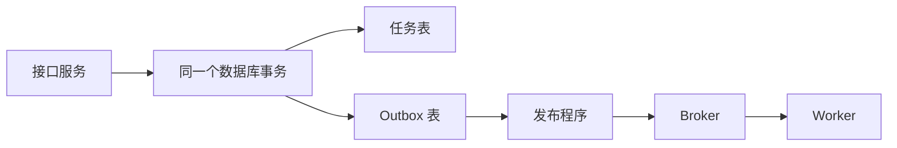

# 04｜数据库和 MQ 之间：Outbox、幂等与事务

[← 上一篇](03-消息的一生与确认边界.md) · [学习目录](../README.md) · [下一篇 →](../03-进阶篇/05-顺序重试与积压治理.md)

> 前置：知道数据库事务可以一起提交多项修改。目标：画出两个原子性边界，并解释其中剩下的重复窗口。

用户已经拿到 `task-123`，任务表也已经存在这条记录。API 正准备往 MQ 发送消息时，进程崩溃了。Worker 从来不知道这个任务，界面却永远显示“排队中”。这个问题发生在生产端，比消费者是否 ACK 更早。

## 两个独立系统，交换顺序救不了双写

先写数据库，再发 MQ，可能有任务、没消息。先发 MQ，再写数据库，可能有消息、没任务。把两句代码放进同一个函数，或者使用 `try/except`，都不会让数据库和 Broker 变成同一个事务资源。

```text
方案 A：数据库提交 ──崩溃──> 尚未发消息
方案 B：消息发送成功 ──崩溃──> 尚未提交数据库
```

真正需要保证的是：“业务接受了任务”这个事实，与“将来必须发送任务消息”这个意图，一起保存。

## Outbox：把发送意图放进本地事务

在业务数据库里增加 `outbox` 表。一次事务同时创建任务和插入待发送消息：

```sql
BEGIN;
INSERT INTO tasks (task_id, state) VALUES ('task-123', 'queued');
INSERT INTO outbox (event_id, task_id, sent)
VALUES ('evt-123', 'task-123', false);
COMMIT;
```

这是结构示意，实际表还需要载荷、创建时间、索引等字段。关键点是这两条记录属于**同一个数据库事务**。事务失败，两者都没有；事务成功，即使 API 立刻退出，后台发布程序也能发现待发送消息。



发布程序取出未发送记录，等待 Broker 确认后再标记已发送。数据库轮询和 CDC（读取数据库变更日志）是两种常见实现方式。Debezium 的 [Outbox Event Router](https://debezium.io/documentation/reference/stable/transformations/outbox-event-router.html)是 CDC 路线的一个具体实现；初学时先理解事务边界，不必同时搭建整套 CDC。

## Outbox 为什么仍然重复

发布程序还有一个不可消失的窗口：Broker 已经确认，但 `outbox.sent=true` 尚未提交。此时退出，重启后会再次发送。

因此 Outbox 解决的是发送意图的可靠保存和可重试发布，没有自动保证一次业务事件在 Broker 中只有一份。若为了避免重复而先标记 sent 再发送，又重新制造了丢消息窗口。

生产实现还要考虑多个发布实例竞争、发布顺序、长时间未发出的告警、归档和磁盘增长。领取 outbox 的事务应尽量短，不要在持有业务行锁时无限等待网络。轮询时使用合适索引和批量；使用领取租约时，要允许租约过期后再次发布，并接受由此产生的重复。

## 幂等要覆盖业务效果

报告 Worker 收到 `evt-123`，完成报告记录，然后提交 ACK。如果在 ACK 前退出，下一次必须识别已经完成的业务。

一个可用的本地事务结构是：

```text
BEGIN
  尝试插入 inbox(consumer_name, event_id)，有唯一约束
  如果已存在：确认之前事务已经提交，跳过效果写入
  如果是新消息：写业务结果、更新任务状态
COMMIT
最后 ACK
```

去重键包含消费者名，是因为通知与统计应该分别处理同一事件。它们共享数据库时，如果仅用全局唯一 `event_id`，通知先处理就可能导致统计被错误跳过。

在 PostgreSQL 中，可以使用 `INSERT ... ON CONFLICT DO NOTHING RETURNING ...` 判断是否首次插入；不要在唯一冲突使事务进入错误状态后继续执行普通 SQL。第 07 篇使用 SQLite，语法与并发能力不同，但要证明的是同一个原子性原则。

仅仅把 `event_id` 放进一张去重表也不够。如果去重记录先提交，业务更新后失败，重投会被当作已完成。必须让去重记录和本地业务效果一起提交，或者使用明确的处理中状态、租约和恢复协议。

## 请求键、事件键和业务键为什么都存在

| 标识 | 防止哪一类重复 | 例子 |
|---|---|---|
| 请求幂等键 | 用户重复提交同一次请求 | 同一次点击的重试 |
| 事件标识 | 同一事件被重复投递 | `evt-123` 被 Broker 重投 |
| 业务操作键 | 不同事件意外表达同一次效果 | 同一订单只能增加一次奖励积分 |

只检查事件标识，无法阻止两个不同事件都要求“给订单 123 加首次支付奖励”。此时还需要例如 `(order_id, reward_type)` 的唯一约束。反过来，若一张订单允许合法发生两次不同奖励，粗暴地对 `order_id` 唯一又会漏掉合理业务。

幂等键定义的是业务事实，不能只从 MQ 的消息编号里机械选择。重复请求的载荷也应一致：同一个键原来要求生成“季度报告”，第二次却变成“年度报告”，应报告冲突，而不是默默返回旧结果。

## 外部 API 不会加入你的数据库事务

现在把“写报告记录”换成“发邮件”。即使在数据库事务里调用邮件 API，数据库回滚也撤不回已经发出的邮件。问题变成：外部服务成功了，但响应丢失时，如何知道要不要重发？

优先寻找外部服务提供的幂等键或可查询的操作编号。每次重试保留同一个逻辑操作键；发生不确定结果时先查询、对账，再决定下一步。工具调用记录可以区分 `pending、succeeded、failed、unknown`，其中 unknown 表示结果未知，不能简单当成没执行过。

若外部系统既没有幂等接口，也无法可靠查询结果，通常不能仅靠本地 MQ 声称“永远不会重复”。这时需要业务可接受的去重、补偿或人工核对流程。例如“发出一封更正邮件”是新动作，不能被描述成撤销了原邮件。

## Exactly-once 的保证范围

“恰好一次”必须说明被计数的效果是什么、由哪些事务资源共同保障。Kafka 可以把消费位点和写回 Kafka 的记录纳入事务；对于独立数据库或外部工具，则需要它们参与相应的协调或幂等机制。数据库唯一约束能保证特定记录只出现一次，不代表一次模型调用只计费一次。

RocketMQ 事务消息通过半消息、本地事务执行及事务状态回查，处理“本地事务结果与消息可见性”的关联。回查需要从可靠记录判断本地事务结果；它也不会自动把消费者的数据库更新和第三方调用合成一个全局事务。产品机制见 [RocketMQ Transaction Message](https://rocketmq.apache.org/docs/featureBehavior/04transactionmessage/)。

## 去重记录何时能删

如果消息最长可能在 30 天后被回放，而去重记录只保存一天，第 2 天的回放就可能重新产生效果。保留窗口应覆盖正常重试、人工补发、灾难恢复和数据回放的实际范围。业务唯一约束常常需要比传输去重记录更长的生命周期。

Outbox 和 Inbox 还要监控增长。删除已发送记录前应明确恢复与审计要求；不能仅按“看起来是旧数据”清理。第 07 篇为了让每一次失败可观察，保留了全部教学记录，并使用独立实验目录避免互相污染。

## 一道带故障点的设计题

任务和 outbox 已提交，发布成功后进程退出；消费者写结果后又退出。最终应期待一条消息还是一个业务结果？

可以有多次投递，但只产生一次预期业务效果。正确设计必须同时承受发布重试和消费重试，而不是只修其中一个窗口。第 07 篇将用真实子进程退出验证这条链路。
