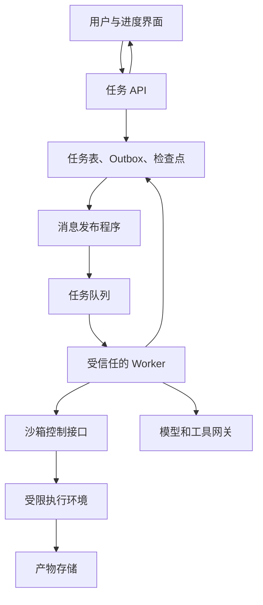
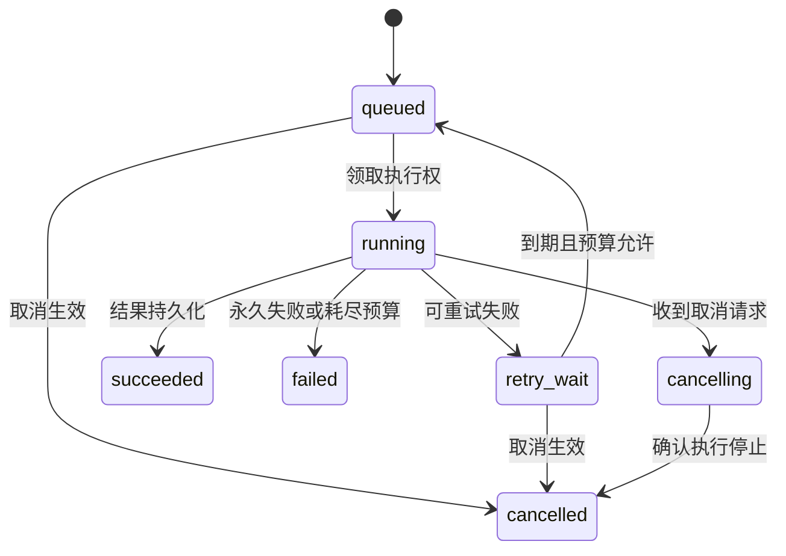

# 06｜把 MQ 放回 Agent 与沙箱架构

[← 上一篇](05-顺序重试与积压治理.md) · [学习目录](../README.md) · [下一篇 →](../04-实践篇/07-可靠消息故障实验.md)

> 前置：第 01～05 篇。目标：能解释“消息已投递”“任务可恢复”“执行被隔离”分别由谁保障。

用户要生成一份报告。平台收到请求后，Worker 要创建沙箱，读取输入，调用模型，执行脚本，再上传产物。这条链路的每一步都有状态。下面是本系列的设计示例，不是对某个沙箱产品内部实现的描述。

## 三种职责不能互相代替

MQ 负责消息存储、分配和相关投递机制。任务或工作流状态决定现在走到哪一步、接下来做什么、失败后从哪里继续。沙箱负责约束执行环境的文件、网络、进程和资源访问。

Worker 收到消息，只证明出现了一次投递。任务执行到第三步，消息里可能仍然只有最初那个 `task_id`；第三步的结果要从持久状态中恢复。沙箱快照也只覆盖其声明的状态范围，不会自动撤销已发出的邮件、外部数据库写入或模型计费。

这与沙箱仓库中的[多 Agent 通信与状态](https://github.com/yushui2022/How-to-learn-Agent-Sandbox/blob/main/文章内容/扩展研究/第三十章-学习笔记-多Agent的通信与状态-快而隐式慢而明确.md)形成接缝：通道传递的是工作和引用，一致性仍要由状态与协议承担。

## 给任务画出可持久化的生命周期

每条状态转换都应是有条件的写入。例如已经 `succeeded` 的任务，不能因为一条迟到的失败消息变成 `failed`。取消与成功同时发生时也要定义竞态规则：由一次条件更新决定最终状态，或允许展示“取消请求到达时任务已完成”。

用户界面可以把更细的步骤展示为进度，但百分比最好来自可解释的阶段或完成量，不要把 token 数随意当作任务完成比例。

## Worker 失联，谁拥有继续执行的权利

一个 Worker 可能死了，也可能只是暂时无法续租。平台给新 Worker 接管任务后，旧 Worker 又恢复，两者可能同时写结果。

通常用租约表示某段时间内的执行权，用递增 `attempt_epoch` 或类似令牌区分新旧执行者。写任务状态时带上预期 epoch；旧 Worker 的写入被拒绝。租约到期本身不会停止旧进程，因此还需取消执行、回收沙箱和拒绝过期令牌。

这个拒绝只有在资源侧实际检查时才有效。如果第三方工具不认识你的 epoch，它仍可能接受旧 Worker 的请求。此时要由受信任的工具网关检查，或使用第三方幂等键。不能因为数据库有一列 `version` 就声称所有外部效果都被隔离。

## 长任务应该一直拿着消息不 ACK 吗

可以让 Worker 在短任务完成后 ACK，理解简单。但任务长到几分钟或几小时，就必须同时处理心跳、确认超时、重平衡和执行续租。

另一种设计是消费者先把消息对应的任务可靠移交到持久执行状态，再 ACK，之后由调度器负责扫描、续租和恢复。这里必须已经有一个持久的接管机制。仅把任务交给内存线程池就 ACK，会把 Broker 的恢复能力提前丢掉。

因此“ACK 一定要等整个业务生命周期结束”也太绝对。更准确的判断是：**下一层是否已经可靠接过责任**。第 08 篇采用小任务完成后 ACK，便于观察；长任务平台需要另行定义交接点。

## 模型调用和工具调用的恢复不同

报告生成包含“读取资料→生成草稿→验证→上传”。每完成一步，保存输入版本、输出引用、状态和尝试信息。再次执行时先读取检查点，复用已经确认有效的产物。

重新调用模型可能产生不同输出、增加费用；工具调用还可能改变外部世界。稳定的逻辑操作标识可以采用 `(task_id, step_id, operation_name)`，具体设计应确保同一逻辑操作重试时不会变。模型每次生成的随机 tool call ID 不一定适合作为跨重试幂等键。

当任务涉及持久定时器、人工审批、并行分支、取消传播和补偿，工作流引擎值得评估。Temporal 将工作流执行状态与事件历史结合，提供持久执行机制；活动产生的外部副作用仍需考虑重试与幂等。[Temporal 工作流执行说明](https://docs.temporal.io/workflow-execution)可用来继续学习。MQ 与工作流系统可能协作，两者回答的问题不同。

## 取消消息不能排在十万条长任务之后

如果控制消息与普通工作共享一个拥堵队列，取消可能迟迟无法到达。任务数据库中应先持久记录取消意图，Worker 在可中断边界和续租时检查；需要及时响应时，再配置独立控制通道。

收到取消不代表沙箱已经停止。应分别记录“已请求停止”和“已确认回收”，并处理宽限期、强制停止与清理失败。沙箱仓库的[失败传播](https://github.com/yushui2022/How-to-learn-Agent-Sandbox/blob/main/文章内容/扩展研究/第三十二章-学习笔记-失败传播-从杀进程到停一棵树.md)进一步讨论了任务树上的依赖与终止。

## 选型先写需求，再看产品

| 需求重心 | 值得评估的方案 | 需要继续问的问题 |
|---|---|---|
| 明确的工作分配、路由和逐条确认 | RabbitMQ 工作队列 | 队列类型、确认、重投、死信可靠性与运维 |
| 多组独立消费、历史重放、持续事件流 | Kafka 常规消费组 | 分区数、保留策略、位点、热点与顺序 |
| 业务消息与本地事务结果关联 | RocketMQ 事务消息 | 回查证据是否持久、消费端是否幂等 |
| 已使用 Redis，需求规模有限 | Redis Streams | PEL 接管、裁剪、持久化、内存与隔离 |
| 规模较小，任务主要落在同一个数据库 | 数据库任务表 | 领取竞争、租约扫描、增长和数据库负载 |
| 长流程、等待信号、分支和恢复 | 工作流引擎 | 历史管理、代码版本、活动幂等和运行成本 |

这张表是需求映射，不是性能排行。一个 Agent 系统可以把报告任务交给工作队列，把完成事件写入日志平台，再用工作流系统管理复杂审批；也可能在当前规模下只需要任务表。每增加一个组件，都要能指出它解决了哪项现有要求。

本系列真实实验选择 RabbitMQ，是因为投递、确认、重投和队列积压容易直接观察。Kafka 作为日志模型的主要对照，用来学习分区与消费组；这不意味着所有 Agent 项目都应选 RabbitMQ。

## 设计一份可验收的最小方案

假设任务最多五分钟，同租户最多同时运行两个，输入文件有版本，结果需要用户查询。你的设计至少应能回答：

1. 接口返回前，任务意图保存在哪里？
2. 重复点击和消息重投分别如何去重？
3. Worker 第三步崩溃后，从哪里判断已完成步骤？
4. 两个 Worker 同时执行时，谁的状态更新被接受？
5. 取消后，怎样确认模型请求、子进程和沙箱资源的处置结果？
6. 文件已上传但任务未标成功时，怎样恢复或清理孤立产物？

下一篇把范围缩小到其中最容易验证的部分：可靠接受、重复发布、进程崩溃和本地业务幂等。先证明这些，再接真实 Broker。
